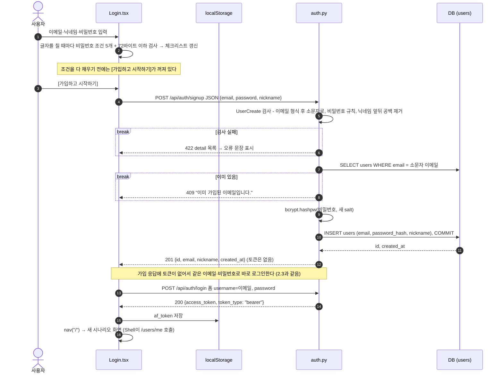
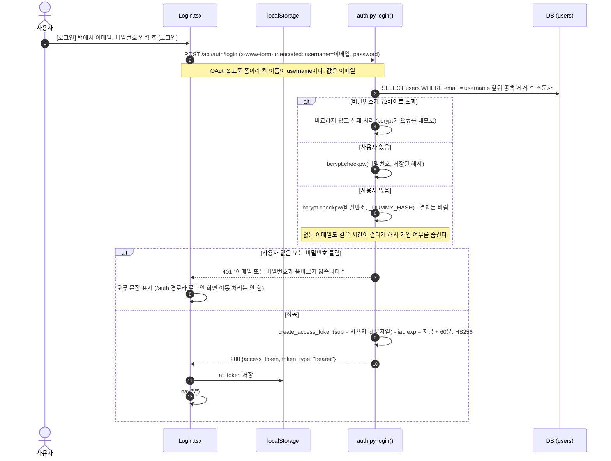
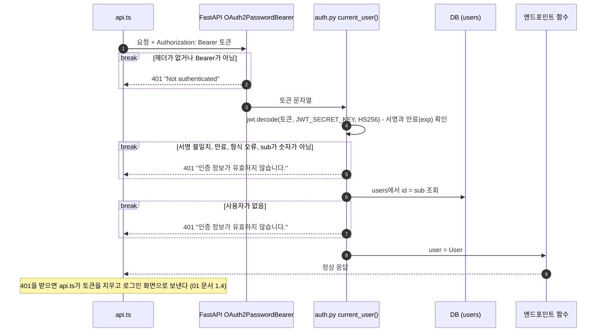
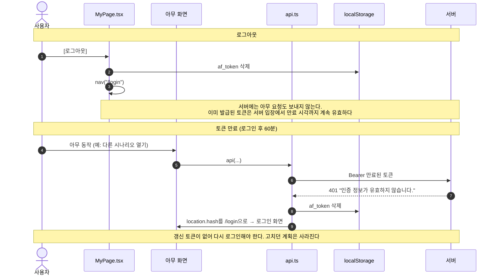

# 2. 가입 · 로그인 · 인증 · 로그아웃

비밀번호는 bcrypt 해시로 저장하고, 로그인하면 JWT(HS256) 액세스 토큰을 준다. 화면은 토큰을 `localStorage`에 두고 모든 API 요청에 붙인다. 세션·갱신 토큰은 없다.

[← 목차](README.md)

## 관련 파일

| 파일 | 하는 일 |
| --- | --- |
| [web/src/pages/Login.tsx](../../web/src/pages/Login.tsx) | 가입·로그인 화면. 비밀번호 조건 실시간 체크(`PW_RULES`), 가입 직후 자동 로그인(`submit`) |
| [web/src/api.ts](../../web/src/api.ts) | 토큰 보관(`localStorage` 키 `af_token`), 요청마다 Bearer 첨부, 401이면 토큰 삭제 후 로그인 화면 |
| [web/src/pages/MyPage.tsx](../../web/src/pages/MyPage.tsx) | 로그아웃 버튼, 토큰 만료 시각 표시 |
| [app/auth.py](../../app/auth.py) | `signup()`, `login()`, `read_me()`, 인증 의존성 `current_user()`, bcrypt·JWT 함수 |
| [app/models.py](../../app/models.py#L24-L30) | `users` 테이블 |
| 테스트 | [tests/test_auth.py](../../tests/test_auth.py) |

## 2.1 화면 구성 (`#/login`)

- **왼쪽**: 도구 소개. "요청에 없던 행동" 예시 카드와 사용 흐름(요청 → 계획 → 모의 실행 → 비교)이 있는 고정 그림이다. 서버를 부르지 않는다.
- **오른쪽**: [가입] / [로그인] 탭. 처음 열면 **가입** 탭이다. 탭을 바꾸면 오류 문장만 지워지고 입력값은 남는다.
  - 가입 탭: 이메일, 닉네임(최대 50자), 비밀번호 + 조건 체크리스트. 조건을 모두 채워야 [가입하고 시작하기]가 눌린다.
  - 로그인 탭: 이메일, 비밀번호. 조건 검사 없음.
- 이미 로그인한 상태에서 `#/login`을 열어도 자동으로 넘어가지 않고 이 화면이 보인다.

---

## 2.2 가입 (가입 직후 자동 로그인)



### 가입 입력 규칙

| 칸 | 규칙 | 화면 (가입 탭) | 서버가 거절할 때 (422) |
| --- | --- | --- | --- |
| `email` | 이메일 형식(`EmailStr`). 저장 전 소문자로 바꿈 | 브라우저 기본 형식 검사 (`type=email`) | `value is not a valid email address: ...` (영문) |
| `password` | 8자 이상 | 체크리스트 "8자 이상" | `String should have at least 8 characters` (영문) |
| | 72바이트 이하 (bcrypt 한도, 한글은 글자당 3바이트) | 넘으면 빨간 줄 "72바이트 이하" | `비밀번호는 72바이트 이하여야 합니다. (한글은 글자당 3바이트)` |
| | 영문 대문자·소문자·숫자·특수문자 각 1개 이상 (공백은 특수문자가 아님) | 체크리스트 4줄 | `비밀번호에 {빠진 종류들}를 하나 이상 넣어 주세요.` 예: `비밀번호에 영문 대문자·숫자·특수문자를 하나 이상 넣어 주세요.` |
| `nickname` | 1~50자, 앞뒤 공백 제거, 공백만은 안 됨 | `maxLength=50`, 필수 | `닉네임을 입력하세요.` 또는 길이 오류 |
| (중복) | 같은 이메일이 이미 있음 (대소문자 무시) | - | 409 `이미 가입된 이메일입니다.` |

비밀번호가 8자 미만이면 그 오류만 나온다. 8자 이상이면 72바이트 초과를 먼저 보고, 그다음 빠진 종류를 한 문장으로 모아 알려 준다.

---

## 2.3 로그인



- 로그인 때는 가입 비밀번호 규칙을 검사하지 않는다. 규칙이 생기기 전에 만든 약한 비밀번호 계정도 로그인된다.
- 없는 이메일과 틀린 비밀번호는 상태 코드(401)와 문장이 똑같다.
- 버튼은 요청 중 "잠시만요…"로 바뀌고 잠긴다.

---

## 2.4 로그인이 필요한 API의 인증 확인 (`current_user`)

`/api/users/me`와 시나리오·계획·실행 API는 모두 엔드포인트 함수가 돌기 전에 이 확인을 거친다. 통과하면 `User` 객체가 함수의 `user` 인자로 들어간다.



모든 401 응답에는 `WWW-Authenticate: Bearer` 헤더가 붙는다.

---

## 2.5 내 정보 (`GET /api/users/me`)

인증 확인을 통과한 `User`를 그대로 돌려준다. 상단 바 닉네임(`Shell`)과 마이페이지가 쓴다.

```json
{"id": 1, "email": "kim@company.com", "nickname": "지순", "created_at": "2026-10-20T11:16:11"}
```

---

## 2.6 로그아웃과 토큰 만료



마이페이지의 "로그인 유지: ○○까지"는 토큰 가운데 조각(payload)을 브라우저에서 base64로 풀어 `exp`를 읽은 값이다. 서명은 확인하지 않는 표시용이다.

---

## 2.7 실제 데이터

가입 요청 `{"email": "Kim@Company.com", "password": "Passw0rd!", "nickname": " 지순 "}` → 201. 이메일은 소문자로, 닉네임은 공백이 제거되어 저장된다.

```json
{"id": 1, "email": "kim@company.com", "nickname": "지순", "created_at": "2026-10-20T11:16:11"}
```

로그인 응답과 토큰 안의 값 (`exp - iat = 3600초`):

```json
{"access_token": "eyJhbGciOiJIUzI1NiIsInR5cCI6IkpXVCJ9.eyJzdWIiOiIxIiwiaWF0IjoxNzkyNDk0OTcxLCJleHAiOjE3OTI0OTg1NzF9.PY4N…", "token_type": "bearer"}
```

```json
{"sub": "1", "iat": 1792494971, "exp": 1792498571}
```

오류 응답과 화면에 보이는 문장:

| 상황 | 응답 | 화면 문장 |
| --- | --- | --- |
| 약한 비밀번호 `password` | 422 `{"detail": [{"type": "value_error", "loc": ["body", "password"], "msg": "Value error, 비밀번호에 영문 대문자·숫자·특수문자를 하나 이상 넣어 주세요.", ...}]}` | `비밀번호에 영문 대문자·숫자·특수문자를 하나 이상 넣어 주세요.` |
| 이미 가입된 이메일 | 409 `{"detail": "이미 가입된 이메일입니다."}` | 그대로 |
| 틀린 비밀번호, 없는 이메일 | 401 `{"detail": "이메일 또는 비밀번호가 올바르지 않습니다."}` | 그대로 |
| 토큰 없이 `GET /api/users/me` | 401 `{"detail": "Not authenticated"}` | (로그인 화면으로 이동) |
| 엉터리 토큰 | 401 `{"detail": "인증 정보가 유효하지 않습니다."}` | (로그인 화면으로 이동) |

DB의 `password_hash`는 `$2b$`로 시작하는 bcrypt 해시이고, 응답에는 어디에도 나오지 않는다.

---

## ⚠️ 알아둘 점

1. 비밀번호 규칙이 화면([Login.tsx](../../web/src/pages/Login.tsx#L7-L13) `PW_RULES`)과 서버([auth.py](../../app/auth.py#L34-L39) `PASSWORD_RULES`)에 따로 적혀 있다. 한쪽만 바꾸면 화면은 통과인데 서버가 거절하는(또는 반대) 일이 생긴다.
2. 가입과 로그인이 요청 두 번이다. 가입은 됐는데 이어지는 로그인이 실패하면 계정은 이미 있다. 같은 값으로 다시 가입하면 409가 나므로 [로그인] 탭을 써야 한다.
3. 로그아웃은 브라우저에서 토큰만 지운다. 서버 측 무효화 목록이 없어서 토큰을 따로 복사해 둔 경우 만료 전까지 쓸 수 있다.
4. 토큰이 `localStorage`에 있어서 같은 출처에서 도는 스크립트는 읽을 수 있다.
5. 서버 422 문장 중 형식·길이 오류는 pydantic 기본 영어 문장이 그대로 보인다. 브라우저가 대부분 먼저 막지만, 예를 들어 `a@b`처럼 브라우저는 통과시키고 서버는 거절하는 이메일도 있다.
6. `JWT_SECRET_KEY`를 바꾸면 이미 발급된 토큰이 모두 401이 된다.
