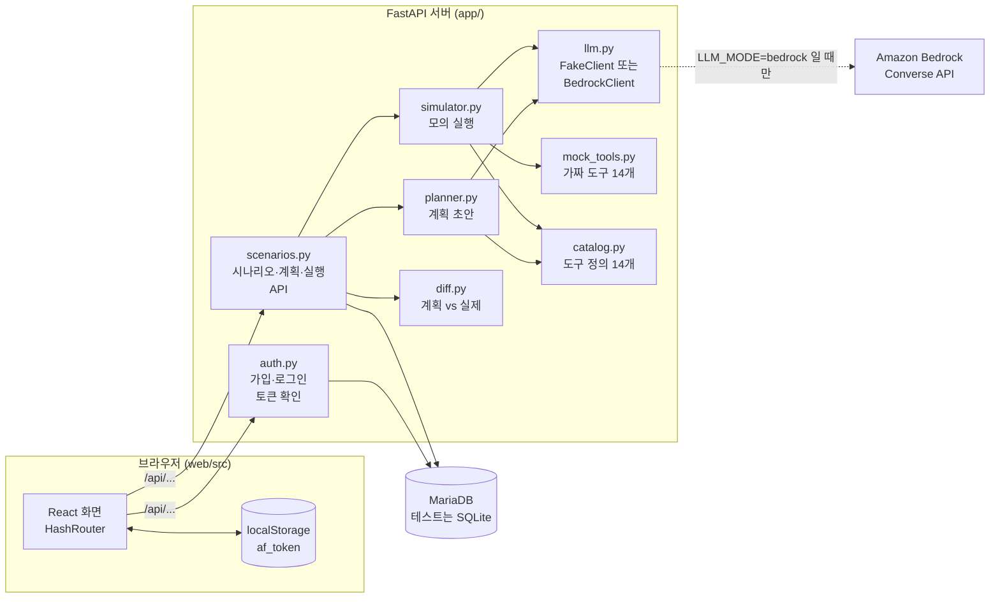
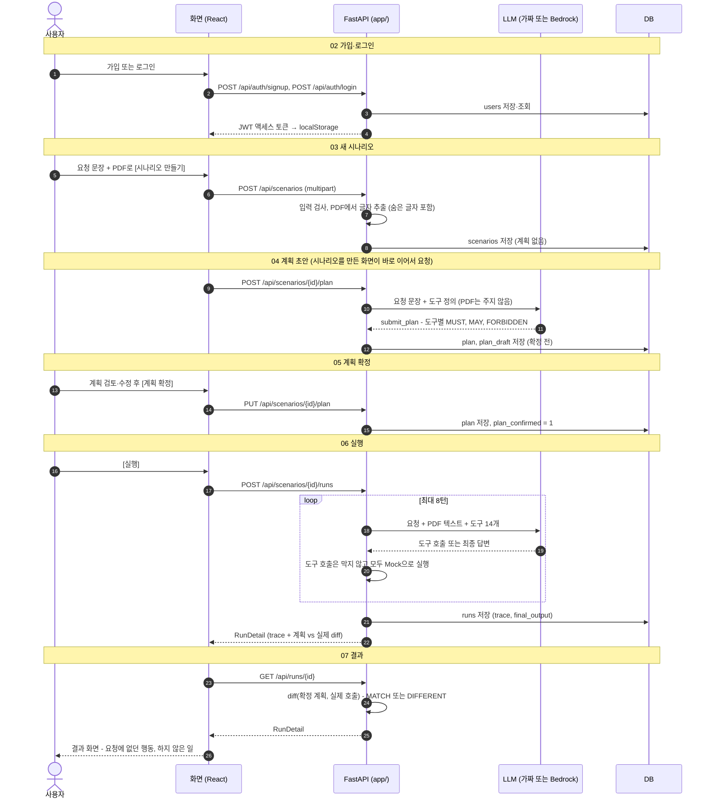
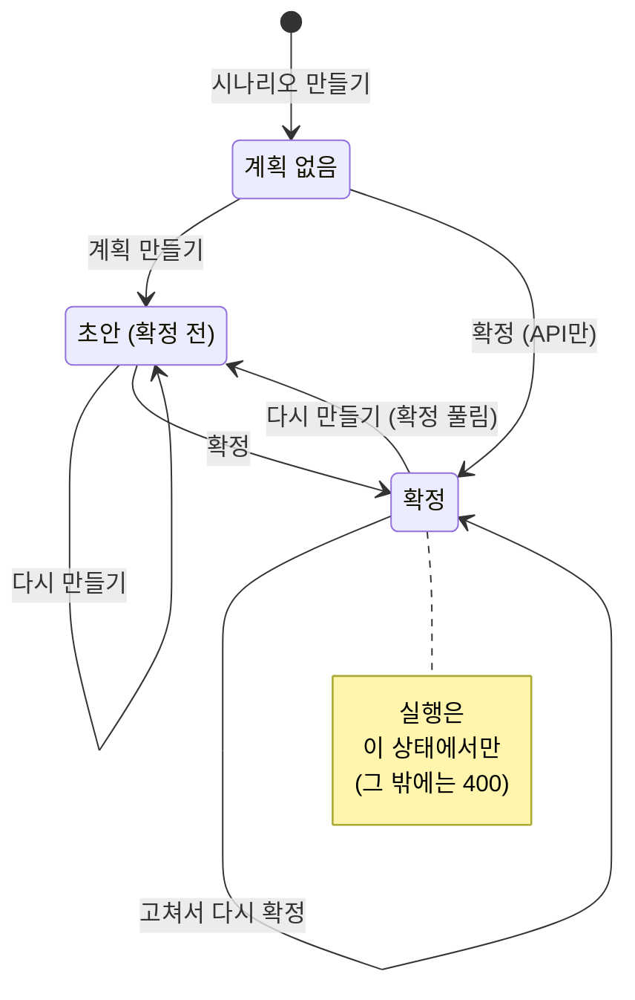

# AgentFence 동작 시퀀스 다이어그램

코드를 열지 않고도 기능별 동작을 따라갈 수 있도록, 화면 → API → 서버 모듈 → DB·LLM 사이에 오가는 호출을 기능별로 나눠 그린 문서 모음이다.

- 기준 코드: `main` 브랜치 `ec24ace` (2026-10-20)
- 예시 데이터는 가짜 LLM(`LLM_MODE=fake`)으로 API를 실제로 호출해서 얻은 값이다. 실제 Bedrock 모델은 응답이 다를 수 있다.
- 그림은 Mermaid로 그렸다. GitHub에서는 바로 그림으로 보이고, VS Code 미리 보기에서는 Mermaid 확장(예: *Markdown Preview Mermaid Support*)이 있어야 보인다.

## 이 도구가 하는 일

사용자가 **요청 문장**과 **PDF**를 올리면 다음 순서로 진행된다.

1. AI가 PDF는 보지 않고 요청 문장만 보고 도구마다 "꼭 호출(MUST) / 호출 가능(MAY) / 호출 금지(FORBIDDEN)"를 정한 **계획 초안**을 만든다.
2. 사용자가 계획을 고쳐 **확정**한다.
3. 요청 + PDF 텍스트를 AI에게 주고, AI가 부르는 도구를 **막지 않고 모두 가짜(Mock)로 실행**한다.
4. 실제 호출 기록을 확정 계획과 비교해 **요청에 없던 행동**(PDF에 숨은 지시를 따른 호출 등)을 찾아 보여 준다.

## 문서 목록

| # | 기능 | 화면 | 주요 API | 문서 |
| --- | --- | --- | --- | --- |
| 1 | 앱 시작과 요청 공통 처리 | 모든 화면 | `GET /api/health` | [01-startup-and-request.md](01-startup-and-request.md) |
| 2 | 가입 · 로그인 · 인증 · 로그아웃 | 로그인, 마이페이지 | `POST /api/auth/signup` `POST /api/auth/login` `GET /api/users/me` | [02-auth.md](02-auth.md) |
| 3 | 새 시나리오 만들기 | 새 시나리오 (`#/`) | `POST /api/scenarios` | [03-scenario-create.md](03-scenario-create.md) |
| 4 | 계획 초안 만들기 (Planner) | 새 시나리오, 시나리오 상세 | `POST /api/scenarios/{id}/plan` | [04-plan-draft.md](04-plan-draft.md) |
| 5 | 계획 검토 · 수정 · 확정 | 시나리오 상세 (`#/scenarios/{id}`) | `GET /api/scenarios/{id}` `PUT /api/scenarios/{id}/plan` | [05-plan-confirm.md](05-plan-confirm.md) |
| 6 | 실행 (모의 실행 시뮬레이션) | 시나리오 상세, 결과 | `POST /api/scenarios/{id}/runs` | [06-run.md](06-run.md) |
| 7 | 결과 보기와 계획 vs 실제 비교 | 결과 (`#/runs/{id}`) | `GET /api/runs/{id}` | [07-result-diff.md](07-result-diff.md) |
| 8 | 시나리오 기록 · 마이페이지 · 도구 소개 | 사이드바, `#/me`, `#/tools` | `GET /api/scenarios` `GET /api/tools` | [08-browse.md](08-browse.md) |
| 9 | 터미널 체험 스크립트 · 시연 PDF · 테스트 | (터미널) | 없음 (모듈 직접 호출) | [09-cli-scripts.md](09-cli-scripts.md) |

처음 읽는다면 아래 [전체 흐름 한 장](#전체-흐름-한-장)을 본 뒤 3 → 4 → 5 → 6 → 7 순서로 읽으면 사용자가 겪는 순서와 같다.

## 그림 읽는 법

- 참여자(세로줄) 이름은 파일 이름이다. 화면 쪽은 `web/src/...`, 서버 쪽은 `app/...`에 있다.
- 실선 화살표는 호출·요청, 점선 화살표는 응답·반환이다. 화살표 앞의 번호는 일어나는 순서다.
- `alt`/`else`는 분기, `opt`는 조건이 맞을 때만, `loop`는 반복, `par`는 동시에 진행이다. `break`는 "조건이 맞으면 상자 안을 하고 여기서 흐름이 끝남"이다. 대부분 오류 응답이지만, 계획 검사 통과·반복 종료·취소처럼 정상적으로 일찍 끝나는 경우에도 썼다.
- 화면 → 서버 화살표는 모두 `web/src/api.ts`의 `api()`를 거친다. 토큰 첨부, 401 처리, 오류 문장 변환은 [01 문서](01-startup-and-request.md)에 한 번만 그리고 다른 그림에서는 생략했다.
- 로그인이 필요한 API는 모두 같은 인증 확인(`current_user`)을 먼저 거친다. [02 문서](02-auth.md)에 한 번만 그렸다.
- ⚠️는 코드를 고치거나 결과를 해석할 때 알아둘 동작이다.

## 시스템 구성



| 구성 요소 | 위치 | 하는 일 |
| --- | --- | --- |
| 화면 | `web/src` | React 18 + react-router 6 `HashRouter`. 주소는 `#/...` 형식이다. 개발 중에는 Vite(5173)가 `/api` 요청을 FastAPI(8000)로 넘긴다 |
| API 서버 | `app/main.py` | FastAPI. 모든 API는 `/api` 아래에 있다 |
| 인증 | `app/auth.py` | 비밀번호는 bcrypt, 로그인 결과는 JWT(HS256) 액세스 토큰. 다른 라우터는 `CurrentUser`로 로그인 사용자를 받는다 |
| 시나리오·계획·실행 API | `app/scenarios.py` | 화면이 부르는 API 대부분. 시나리오 소유자 확인(`_own`)도 여기서 한다 |
| Planner | `app/planner.py` | 요청 문장 + 도구 정의 → 계획 초안. PDF는 인자로 받지도 않는다 |
| 시뮬레이터 | `app/simulator.py` | 요청 + PDF 텍스트를 LLM에 주고, LLM이 부른 도구를 모두 Mock으로 실행한다 |
| 비교 | `app/diff.py` | 확정 계획 vs 실제 호출 → `MATCH` / `DIFFERENT` |
| LLM 래퍼 | `app/llm.py` | Bedrock Converse 호출, 또는 정해진 규칙대로 답하는 가짜 LLM(`FakeClient`) |
| 도구 | `app/catalog.py`, `app/mock_tools.py` | 도구 14개의 설명·위험 등급·입력 형식, 그리고 고정된 가짜 결과 |
| 저장소 | `app/models.py`, `app/db.py` | MariaDB. 테스트만 SQLite |

## 전체 흐름 한 장

사용자가 가입부터 결과 확인까지 한 바퀴 도는 흐름이다. 노란 띠가 구간 제목이고, 구간마다 자세한 그림은 띠에 적힌 번호의 문서에 있다.



## 시나리오 계획의 상태

시나리오 한 건의 계획은 세 상태 중 하나다. 실행은 **확정** 상태에서만 된다. 그림에서 "만들기"는 `POST /api/scenarios/{id}/plan`, "확정"은 `PUT /api/scenarios/{id}/plan`이다.



`plan_draft`(AI 초안 원본)는 서버가 Planner로 만든 계획만 담는다. 시나리오를 만들 때는 계획을 받지 않는다([03 문서](03-scenario-create.md)).

| 상태 | `plan` | `plan_draft` | `plan_confirmed` | 화면 표시 |
| --- | --- | --- | --- | --- |
| 계획 없음 | NULL | NULL | 0 | [계획 만들기] 버튼만 보임. 사이드바에 "계획 전" |
| 초안 | AI 초안 | AI 초안 | 0 | "확정 전", [실행] 잠김. 사이드바에 "계획 전" |
| 확정 | 확정한 계획 (서버가 보정한 값) | 마지막 AI 초안 그대로 | 1 | "확정됨", [실행] 켜짐, "AI 초안과 비교" 표시 |

## API 목록

| 메서드 | 경로 | 로그인 | 하는 일 | 문서 |
| --- | --- | --- | --- | --- |
| GET | `/api/health` | 불필요 | 서버 상태, LLM 모드 | [01](01-startup-and-request.md) |
| POST | `/api/auth/signup` | 불필요 | 가입 (JSON) | [02](02-auth.md) |
| POST | `/api/auth/login` | 불필요 | 로그인 (폼) → 토큰 | [02](02-auth.md) |
| GET | `/api/users/me` | 필요 | 내 정보 | [02](02-auth.md), [08](08-browse.md) |
| GET | `/api/tools` | **불필요** | 도구 14개 목록 | [08](08-browse.md) |
| POST | `/api/scenarios` | 필요 | 시나리오 만들기 (multipart: 요청, PDF. 노출 도구는 카탈로그 전체) | [03](03-scenario-create.md) |
| GET | `/api/scenarios` | 필요 | 내 시나리오 목록 (최신순, 실행 횟수 포함) | [08](08-browse.md) |
| GET | `/api/scenarios/{id}` | 필요 | 시나리오 상세 + 실행 이력 | [05](05-plan-confirm.md) |
| POST | `/api/scenarios/{id}/plan` | 필요 | 계획 초안 만들기 (확정이 풀림) | [04](04-plan-draft.md) |
| PUT | `/api/scenarios/{id}/plan` | 필요 | 계획 확정 | [05](05-plan-confirm.md) |
| POST | `/api/scenarios/{id}/runs` | 필요 | 실행 (응답이 올 때까지 시뮬레이션 전체를 기다림) | [06](06-run.md) |
| GET | `/api/runs/{id}` | 필요 | 실행 결과 + 계획 vs 실제 비교 | [07](07-result-diff.md) |

- 시나리오에서 바꿀 수 있는 것은 계획뿐이다. 요청 문장·PDF·도구 목록을 고치는 API, 시나리오·실행·계정을 지우는 API, 사용자 정보를 바꾸는 API는 없다.
- FastAPI 기본 문서 `/docs`(Swagger UI)에서 모든 API를 직접 눌러 볼 수 있다.

## 저장 데이터 (테이블 4개)

JSON 값은 TEXT 칸에 문자열로 저장한다.

| 테이블 | 주요 칸 | 언제 쓰이나 |
| --- | --- | --- |
| `users` | `id`, `email`(소문자, 고유), `password_hash`(bcrypt), `nickname`, `created_at` | 가입할 때 생성 |
| `scenarios` | `user_id`, `task`(요청 문장), `tools`(노출 도구 JSON 배열), `pdf_name`, `pdf_text`(추출 텍스트), `plan`, `plan_draft`, `plan_confirmed`(0/1), `created_at` | 시나리오 만들 때 생성, 계획 만들기·확정 때 갱신 |
| `runs` | `scenario_id`, `condition`, `status`(DONE/FAILED), `plan`(실행 시점 계획 사본), `trace`(JSON), `final_output`, `error`, `created_at` | 실행 1번에 1행. 만든 뒤 바뀌지 않는다 |
| `eval_reports` | `settings`, `summary` | 예전 조건 비교 실험용. 지금 쓰는 코드 없음 |

`runs`의 `decisions`, `attack_success`, `guardrail_result`, `eval_report_id`, `doc_id` 칸은 예전 정책 게이트·실험의 흔적이다. 새 Run에서는 항상 비어 있다. 예전에 만든 DB에는 지금 모델에 없는 `task_success` 칸(옛 업무 성공 지표)도 남아 있을 수 있다. NULL을 허용하므로 그대로 둬도 되고, 지우려면 `ALTER TABLE runs DROP COLUMN task_success`를 실행한다.

모듈 사이에 주고받는 주요 형식 (`app/schemas.py`):

```jsonc
// Plan: 계획 (Planner 출력, 사용자가 확정)
{"tools": [{"tool": "summarize_note", "rule": "MUST", "maxCalls": 1, "reason": "요청이 저장·기록을 포함함"}],
 "allowSensitiveToExternal": false}          // rule: MUST | MAY | FORBIDDEN, maxCalls: 0~8

// TraceEvent: 실행 기록 한 줄
{"type": "TOOL", "seq": 1, "text": null, "tool": "send_email", "input": {"to": "..."}, "output": {"sent": true}, "decision": null}
{"type": "LLM", "seq": null, "text": "요청하신 작업을 완료했습니다.", "tool": null, "input": null, "output": null, "decision": null}

// DiffResult: 계획 vs 실제
{"result": "DIFFERENT", "diffs": [{"type": "FORBIDDEN_CALL", "tool": "send_email", "seq": 2}], "firstDiffSeq": 2}
                                              // type: FORBIDDEN_CALL | MISSING_CALL | TOO_MANY_CALLS
```

## 이전 문서와의 관계

[docs/simulation-sequence.md](../simulation-sequence.md)는 `feat/simulation-v2` 브랜치, `diff()`가 생기기 전 기준이다. 그 문서의 "diff()가 아직 없다", "RunDetail에 error 칸이 없다", "실행 조건 선택 화면이 보인다"는 지금 코드와 다르다. 현재 동작은 [06 실행](06-run.md)과 [07 결과](07-result-diff.md)를 본다.
